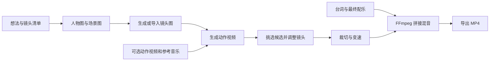

<p align="center">
  
</p>

<h1 align="center">卧巧 · WoQiao</h1>

<p align="center">把人物、动作、镜头和音乐，组织成你自己的 AI 短片。</p>

**卧巧是一个本地运行、通过模型 API 生成素材的 AI 漫剧与短视频创作工作台。** 适合个人创作者制作多镜头漫剧、角色动作片段、舞蹈与音乐短视频。你可以上传人物图和动作参考，逐镜生成、挑选素材，再裁切、调整速度、加入台词和配乐，导出一条视频。

当前为 **早期预览版**。重点是让创作者逐镜掌控素材与剪辑；生成质量需要人工判断，人物一致性和动作卡点仍依赖模型效果及反复挑选。仓库包含可运行代码，不包含模型权重、API 额度或已经验证的商业级成片效果。

## 能做什么

| 能力 | 当前实现 |
| --- | --- |
| 镜头工作台 | 建立多个项目，编辑镜头描述、顺序、时长与画幅；本地保存项目 |
| 参考图与镜头图 | 上传人物图、场景图，调用图像 API 生成镜头图；GPT Image 参考图路径使用编辑接口 |
| 人物与动作参考 | 将角色/构图图片、可选动作视频和可选参考音乐送入 Seedance 多模态视频接口 |
| 运镜辅助 | 固定、跟拍、推近、抬镜揭示、小幅环绕五种提示词预设；不是三维相机轨迹控制 |
| 候选与导入 | 同一镜头生成多次后挑选候选，也能直接导入外部制作的视频 |
| 任务恢复 | 保存视频生成任务 ID；具备 ID 的任务可以继续查询原任务 |
| 配乐与剪辑 | 手工打时间标记、按标记调整镜头长度、裁切、0.5–2 倍变速、调节原声音量、叠加台词与背景音乐 |
| 成片导出 | 本地 FFmpeg 按镜头顺序拼接，导出横屏、竖屏或方形 MP4；当前动作工作台输出为 720 级画幅、24 fps |
| 其他创作入口 | 保留上游的六阶段创作流程、图文短视频、数字人流程和独立生成工作台；能力与配置因入口而异 |

**参考音乐与最终配乐相互独立。** 可以先把人物动作做好，再加入成片音乐；需要动作跟随某段节奏时，提前导入参考音乐，并在对应镜头启用。手工时间标记帮助安排剪切位置，不会自动修正生成视频里人物动作的落拍。

## 从想法到一条短片



最小尝试建议从 **一个角色、三个镜头、每镜约 5 秒** 开始。先检查角色外貌、动作和镜头衔接，再增加人物与片长。具体步骤见 [制作第一条短片](docs/first-video.md)。

## 快速开始

### 环境

- Python **3.11+**，建议 3.12。
- Node.js **20.9+**，建议 22；npm。
- [uv](https://docs.astral.sh/uv/) 或 Python venv/pip。
- FFmpeg：人物动作工作台可使用 `imageio-ffmpeg` 提供的可执行文件；使用其他传统流程时，建议将系统 `ffmpeg` 安装到 PATH。
- 模型 API 账号与可用额度。云端模型推理不要求本地部署 GPU；本地编码仍会消耗 CPU 和磁盘空间。

```bash
git clone https://github.com/wzy11p/woqiao.git
cd woqiao
```

**终端一：后端**

```bash
cd backend
uv sync --locked --python 3.12
cp config.yaml.example config.yaml
uv run --frozen python api_server.py
```

Windows 可将 `cp` 替换为 `copy`。已有 `config.yaml` 时不要覆盖它。

不用 uv 时：在 `backend` 中创建并激活虚拟环境，执行 `python -m pip install -r requirements.txt`，然后 `python api_server.py`。

**终端二：前端**

```bash
cd frontend
npm ci
npm run dev -- --hostname 127.0.0.1
```

打开 [http://127.0.0.1:3000](http://127.0.0.1:3000)，进入「人物与动作」，或直接打开 `/pipelines/action-transfer`。

正式本地运行可使用 `npm run build`，再执行 `npm start -- --hostname 127.0.0.1`。后端默认监听 `127.0.0.1:8000`。

也提供 `bash install.sh` 与 Windows `install.bat` 安装脚本；它们会安装依赖并准备配置，运行前可先检查脚本内容。

### 接入模型

在页面「设置」填写对应供应商的 API Key，或编辑 `backend/config.yaml`。密钥保存在本机配置文件中；示例配置不含真实凭证。

| 用途 | 代码接入点 | 配置位置 |
| --- | --- | --- |
| 人物与动作视频 | 火山方舟 / Seedance 多模态适配器 | `api_providers.ark` |
| GPT Image 生图与参考图编辑 | OpenAI 图像适配器 | `api_providers.openai` |
| 其他生图、视频与剧本功能 | Seedream、通义万相、可灵及多种 LLM/VLM 适配器 | 对应供应商配置 |
| 音乐与台词 | 从外部导入音频文件 | 项目内上传，无需音乐模型 Key |

人物动作项目有自己的图像/视频模型选项，和传统六阶段流程的默认模型配置分开。此版本代码默认标识为 `gpt-image-2` 与 `doubao-seedance-2-0-260128`；**代码内存在某个模型标识，不代表你的账号已开通该模型或所有能力**。以供应商账号实际可用的模型、权限和接口参数为准。

本仓库没有直连 Suno，也没有声音克隆模块。可以在外部制作音乐或台词后导入。API 调用由供应商计费；本次发布验证未调用付费生成接口。

## 当前边界

- **人物一致性是参考约束，不是保证。** 图像、动作参考与提示词会传给模型，仍可能出现换脸、服装漂移、肢体错误，需要重新生成或更换候选。
- **自动拼接已有，自动导演与精确动作卡点未完成。** 导出会执行你指定的顺序与裁切；不会自动判断哪个动作最好、自动识别节拍或重做舞蹈动作。
- **这是本地单用户工具。** 没有完整登录、租户隔离、配额、计费和任务队列体系；不要直接作为开放公网服务运行。
- **项目在本地，推理在云端。** 点击生成时，相关提示词及参考图片/视频/音频会发送给所配置的模型服务商。
- **验证范围有限。** 有模型请求契约、项目保存、媒体路径限制和本地合成测试；尚未完成真实付费模型的端到端成片验收，也没有 Windows 安装实测。

## 架构与目录

```text
Next.js / React 工作台
        │ HTTP：项目、素材、生成任务、导出
FastAPI 后端
        ├── motion 镜头工作流 ── 图像/视频模型适配器 ── 云端 API
        ├── 六阶段编排器与其他流水线
        ├── 本地 JSON / 媒体存储
        └── FFmpeg 裁切、变速、拼接与混音

frontend/                    页面、组件和模型选择界面
backend/api/                 HTTP 路由
backend/pipelines/motion.py  人物动作、参考素材、项目保存与导出
backend/models/              图像、视频、LLM/VLM 适配器和模型注册表
backend/core/                原有六阶段创作流程
backend/tests/               回归测试
backend/config.yaml.example 空密钥配置模板
docs/                       入门步骤与来源说明
```

运行数据位于 `backend/code/` 和 `backend/temp/`，均不提交到 Git。项目及长期素材位于 `backend/code/data/motion/` 与 `backend/code/result/`；清理前请备份。`backend/config.yaml` 同样不提交。

### 开发检查

```bash
# 后端，无付费模型请求；包含真实 FFmpeg 合成测试
cd backend
uv run --frozen python -m unittest discover -s tests -v

# 前端，另一个终端
cd frontend
npm ci
npm run build
```

GitHub Actions 会运行上述后端回归与前端构建。测试通过不等于云端生成质量通过验收。

发布前验证（2026-10-08）：仅用待发布文件建立干净副本，重新安装依赖；21 项后端测试通过，前端生产构建通过。未调用付费生成接口。

## 来源与许可

卧巧是在 [Innate-Labs / XiaoYunQue](https://github.com/Innate-Labs/xiaoyunque) 本地源码基础上持续修改的衍生项目，沿用其前后端与多阶段工作流基础，新增和调整了人物动作工作台、参考素材流、剪辑导出与品牌界面。保留上游 [MIT 许可证](LICENSE) 及其中的 Video-Claw / [FilmAgent](https://github.com/HITsz-TMG/FilmAgent) 和 XiaoYunQue 版权声明。

这是独立维护的项目，与同名商业产品及各模型供应商无官方从属关系。来源范围详见 [第三方说明](docs/third-party-notices.md)。
